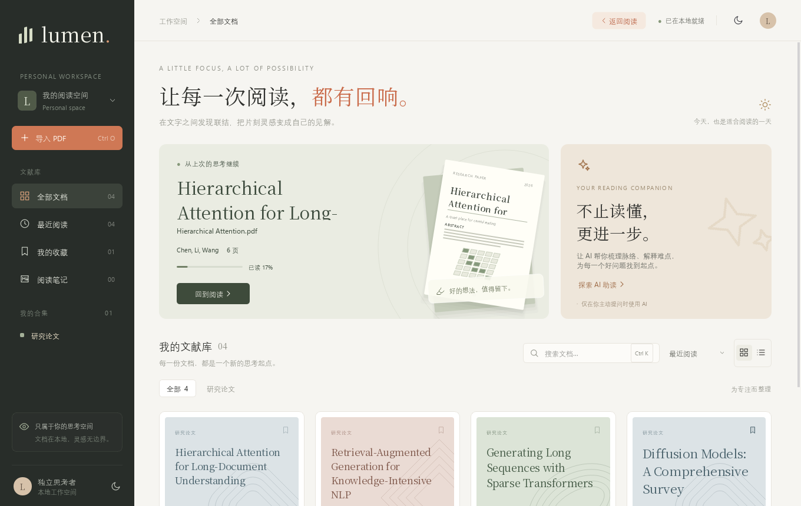

  

<h1 align="center">Lumen</h1>

  <strong>专注阅读，安静思考。</strong> 
  一款免费、开源的 PDF 文献阅读器 —— 读论文、跟引用、做标记、记笔记，一处完成。

  
  
  
  

  

---

## 为什么是 Lumen

读文献最怕的不是难，而是被打断：找不到刚才读到哪、点开参考文献就回不来、划过的重点散落各处、
复制一段话出来全是断行。Lumen 想做的，是让这些小麻烦都消失，把注意力还给内容本身。

- **安静的界面**：暖色纸感的版面、克制的配色与柔和的动效，长时间阅读不累眼。
- **为论文而生**：目录、缩略图、参考文献预览、阅读位置记忆，读长文也不迷路。
- **标记即笔记**：高亮、下划线、批注随手加，最后一键整理成 Markdown 笔记。
- **免费、开源、离线**：不需要账号，不上传文件，你的文献只留在你的电脑上。

## 功能亮点

### 读得顺

打开就回到上次读到的那一页；页面清晰（高分屏同样锐利），缩放、跳页、翻页都停在你想看的位置。
左侧栏随时切换**目录**、**批注**与**缩略图**，长篇论文结构一目了然。

### 跟得上引用

正文里的 `[1]` 一点即开**参考文献预览卡**——不用跳走也能先看清引用的是哪篇；想细看就「跳转到条目」，
看完按 `Alt + ←` 回到原处。图表、章节链接同样适用。

  

### 找得到

全文搜索边输边出结果，每条结果都带上下文，`F3` 在命中之间来回跳转，命中位置会被醒目地标出。

  

### 记得住

- **五色高亮**、下划线、删除线、波浪线，中文也能精确选到每一个字；
- 手写、便签、文本框、签名、时间戳，PDF 上想怎么标就怎么标；
- 所有批注汇总在批注面板，可以补写笔记、点击回到原文；
- 一键**导出 Markdown 笔记**：按页整理好摘录与想法，直接放进 Obsidian、Notion 或 Typora。

### 复制不再断行

「去换行复制」会自动合并 PDF 排版造成的换行和断词，粘贴到翻译工具或笔记里就是一段完整的话。

### 夜里也舒服

浅色 / 深色界面随心切换；**夜间模式**把页面变暗但保留图表颜色，**护眼模式**给页面换上暖色纸张。

  

### 还能做这些

- **加密 PDF**：输入密码即可阅读、搜索、识别与导出，另存时保留原有加密；
- **OCR 文字识别**：扫描版文献也能把文字识别出来，复制或保存为文本；
- **格式转换**：导出为 Word、Excel、TXT 或图片；
- **页面整理**：删除、旋转、合并 PDF，添加半透明水印，随时撤销。

### AI 助读（可选）

接入任意 OpenAI 兼容的大模型服务——DeepSeek、通义千问、Kimi、智谱、豆包、硅基流动、OpenAI、Gemini，
或本机运行的 Ollama：

- 选中文字右键 **AI 翻译 / AI 解释**；拖框选取**公式或图表**让 AI 讲解；
- 一键**结构化总结**、**TL;DR**、**推荐问题**，**速读高亮**直接在页面上标出最该读的句子，或直接就全文提问，回答里的 **[p.N] 点一下就跳回原文**；
- 满意的回答可**存为批注**，和你的笔记放在一起。

AI 默认关闭，只在你主动发起时才把所选内容发送给**你自己配置**的服务；首次发送前会征得同意，
API Key 保存在 Windows 凭据管理器中，不写入任何文件。

## 0.0.6 开发分支：桌面研究工具

以下功能位于当前开发分支，仍需验收，尚未包含在已公开的 0.0.6 安装包中。

- **段落对照翻译**：先预览要发送的段落，源译文同行对照；数字与术语异常提示核对，缓存仅留在当前窗口内存。
- **笔记与引用**：Markdown 模板、批注来源追踪、同目录双链/反向链接、素材插入、中文 Word/PDF 导出，BibTeX/RIS 与 CSL JSON 交换及 DOI 元数据查询。
- **Zotero**：只读合集与完整条目元数据，跳回个人/群组库；导出保留加密的带批注 PDF，书目与批注交换分别处理。
- **阅读与搜索**：封面单独的书本双页、分屏、只读旋转预览、页览、F11 演示；页范围/整词/正则搜索、本机全文索引与命中跳页、目录监控和重复文件检查。
- **长文 AI**：章节/图注分块、分层摘要、多文档对比与综述草稿、可选向量检索、请求预算和原文短引核对。短引存在不代表结论正确。
- **结构与无障碍**：表格 Markdown/CSV、视觉模型公式转 LaTeX、系统本地朗读、高对比度、Ctrl+Shift+P 命令面板；EPUB 只读阅读。

详细入口、隐私与能力边界见 [功能说明](docs/01_功能说明.md)。加密文档不会自动写入明文翻译缓存或全文索引；笔记/表格导出明文需要确认。当前正式安装包仍为 0.0.6；代码签名、自动安装更新、云同步与移动端尚未提供。

## 下载安装

1. 前往 [Releases](https://github.com/lryoooow/Lumen-PDF-Reader/releases) 下载最新的 `PDFReader-Setup-<版本>.exe`；
2. 双击运行安装向导，按提示完成安装；
3. 打开 Lumen，或在任意 PDF 上右键 →「打开方式」选择 Lumen。

目前支持 **Windows 10 / 11（64 位）**，无需安装 Python 或其他依赖。

  

## 路线图

- [x] 目录、缩略图、参考文献预览与跳转
- [x] 多色高亮、批注笔记、Markdown 导出
- [x] 夜间 / 护眼模式、阅读位置记忆
- [x] OCR 文字识别、格式转换
- [x] AI 助读：划词翻译 / 解释、全文总结与问答、框选公式解释
- [x] 多标签页同时打开多篇文献
- [x] 段落对照翻译：预览、术语与数字核对、原文定位、停止与重试
- [x] 双页 / 书本视图、独立分屏与全屏演示
- [x] 文献库首页：收藏、按文件夹分组与检索
- [x] 划词翻译浮窗、离线查词卡与写作素材库
- [x] 从 Zotero 导入批注（只读本机库）
- [x] 自动保存与崩溃恢复（整份快照 + 文献库恢复横幅）
- [x] 文本选择手势：双击选词、三击选行、Shift 扩展、Ctrl+A、跨页拖选与边缘自动滚动
- [x] 长文档优化：主线程分片全文索引，AI 首次动作不再一次性逐页取词
- [x] 会话恢复与单实例：启动回到上次打开的标签，第二次启动把文件转交已运行窗口
- [x] 崩溃诊断：`crash.log` + 「关于」里导出脱敏诊断包

## 参与贡献

欢迎提交 Issue 反馈问题或建议，也欢迎 Pull Request。想参与开发，可以从 [docs/](docs/README.md) 开始了解项目。

## 许可证

Lumen 基于 [GNU AGPL-3.0](LICENSE) 开源发布，可以免费使用、学习与修改。

查词卡使用的离线词典精简自 [ECDICT](https://github.com/skywind3000/ECDICT)（MIT 许可，许可文本见 `src/pdfreader/resources/dict/LICENSE`）。
