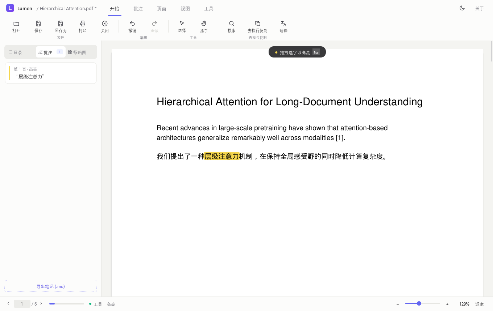
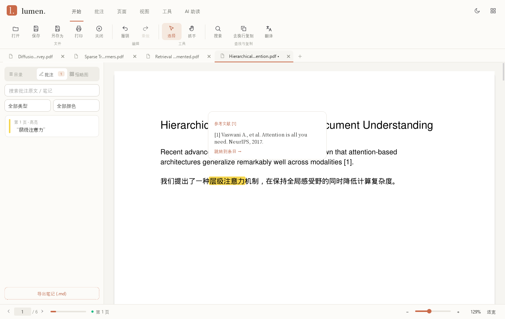
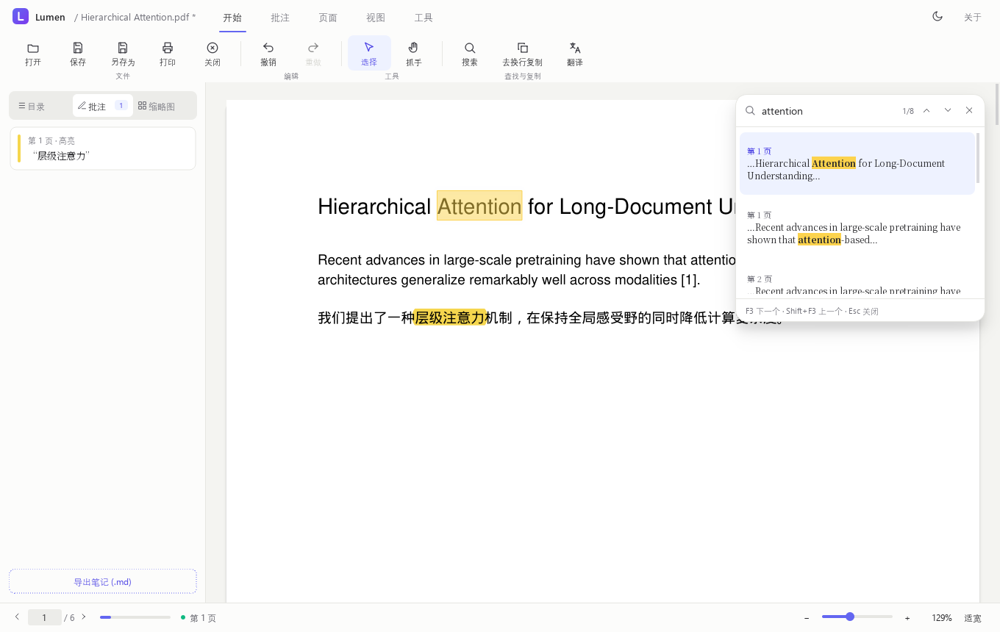

# 功能说明

> 适用版本：Lumen 0.0.6。快捷键为 Windows 下的实际绑定（Qt 标准快捷键）。
> 面向使用者与测试者：每个功能在哪、怎么用、会看到什么反馈。界面实现细节见
> [04_界面与交互规范](04_界面与交互规范.md)。

---

## 1. 功能区（按选项卡）

### 1.1 开始

| 功能 | 快捷键 | 说明 |
| --- | --- | --- |
| 打开 | Ctrl+O | 文件对话框默认定位到最近文件所在目录，可多选；每份文档开在新标签（已打开的直接切过去）；加密文档弹**密码框**（最多 3 次） |
| 保存 | Ctrl+S | 增量存回原文件；失败时先说明原因，再进入另存为 |
| 另存为 | Ctrl+Shift+S | 可选原文件（自动转为增量保存）；加密文档保持加密与权限 |
| 打印 | Ctrl+P | 系统打印对话框 → 进度框，可取消 |
| Zotero 批注 | — | 把当前文档在 Zotero 里的批注（高亮 / 下划线 / 便签 / 文本框 / 区域 / 墨迹）导入这份 PDF，整批一次撤销；只读 Zotero 本机库（拷贝数据库快照再读，绝不写 Zotero），按文件路径对应到同一个附件。默认自动查找 Zotero 数据目录，找不到时让用户选一次并记住 |
| 关闭 | Ctrl+F4 | 关闭当前标签；有未保存改动时询问 保存 / 不保存 / 取消 |
| 切换标签 | Ctrl+Tab / Ctrl+Shift+Tab | 标签栏在功能区下方：拖动排序、中键或 ✕ 关闭、右键「关闭其他标签」；改过未保存的标签名带「•」 |
| 撤销 / 重做 | Ctrl+Z / Ctrl+Y | 合并之后不可撤销（状态栏提示） |
| 选择 / 抓手 | — | 与批注工具同属一组互斥工具 |
| 搜索 | Ctrl+F | 右上角搜索浮层；F3 / Shift+F3 下一个 / 上一个 |
| 去换行复制 | Ctrl+Shift+C | 复制选中文字并合并 PDF 排版换行与断词（便于粘贴到翻译 / 笔记） |
| 翻译 | — | AI 翻译选中的文字（见 §1.6）；未选中文字时提示先选择 |

### 1.2 批注

| 功能 | 操作 | 说明 |
| --- | --- | --- |
| 高亮 | 拖拽选字，按当前颜色实时预览，松开提交并闪动 | 「颜色」下拉为 5 色色板（黄 / 绿 / 蓝 / 粉 / 橙），记住选择；多行高亮是**一条**批注，一次撤销 |
| 下划线 | 拖拽选字，蓝色细线预览，松开提交 | 右键选中文字还可选：高亮 / 删除线 / 波浪线 |
| 手写 | 按住拖动，红色笔迹实时预览 | 松开提交为一条墨迹批注 |
| 便签 | 单击页面 → 输入内容 | |
| 文本框 | 单击页面 → 输入文字，文字直接显示在页面上 | 按文字量自动定大小（最宽 260pt 折行）；侧栏双击可改文字；中文 / 旋转页正常显示 |
| 橡皮擦 | 单击批注删除 | 点在空处提示「这里没有批注」 |
| 签名 | 手绘或选择图片 → 单击页面放置 | 放置完成或 Esc 后回到「选择」 |
| 时间 | 单击页面放置当前日期时间 | 同上 |

* 选中批注工具时，阅读区顶部出现提示胶囊（如「● 拖拽选字以高亮  Esc」）。
* 中文可**精确到字**选择与高亮。

### 1.3 页面

| 功能 | 说明 |
| --- | --- |
| 删除页 | 作用于**当前页**（视口中露出最多的页，组标题「当前页 · 第 N 页」实时显示）；需确认；只剩一页时禁用 |
| 旋转 | 当前页顺时针 90° |
| 合并 | 追加另一个 PDF 到末尾；加密 / 损坏的文件会说明原因，且不影响当前文档与撤销历史 |
| 水印 | 输入文字 → 选「仅当前页 / 全部页」；半透明、居中，中文正常显示 |

### 1.4 视图

| 功能 | 快捷键 | 说明 |
| --- | --- | --- |
| 侧边栏 | F4 | 目录 / 批注 / 缩略图；拖右边缘调宽度（220–520，双击恢复 280），记住宽度 |
| 后退 / 前进 | Alt+← / Alt+→ | 链接、目录、缩略图、搜索结果、批注、页码跳转都会记入历史（上限 50 步） |
| 放大 / 缩小 | Ctrl++ / Ctrl+-、Ctrl+滚轮 | 范围 10%–800%（100% = 实际大小 96 DPI），缩放后保持阅读位置 |
| 适宽 / 适页 / 原大 | Ctrl+0 / Ctrl+9 / Ctrl+1 | 适宽 / 适页随窗口大小自动重算；「原大」只有快捷键 |
| 阅读模式 | — | 正常 / **夜间**（页面反色，保留图表色相）/ **护眼**（暖色纸张）；状态栏显示当前模式 |

### 1.5 工具

| 功能 | 说明 |
| --- | --- |
| OCR | 下拉选「当前页 / 全部页」；后台识别，进度可取消；结果对话框可复制、另存为 TXT；依赖缺失时禁用并提示 |
| 导出 | PNG / JPEG / TXT / Word / Excel；后台转换；目标已存在先确认覆盖；完成后列出实际生成的文件 |
| 导出笔记 | 全部批注 → Markdown（按页分节：类型、被标记的原文、笔记） |
| 文档信息 | 文件路径与大小、标题、作者、页数、是否加密等 |

### 1.6 AI 助读（可选的联网功能，默认关闭）

| 功能 | 入口 | 说明 |
| --- | --- | --- |
| AI 面板 | Ctrl+J / 「AI 面板」 | 右侧抽屉（默认 380px，宽度动画；拖左边缘调宽度 320–760，双击恢复默认，记住宽度）：预设动作、对话气泡（你的请求在右、AI 回答在左）、输入框（Enter 发送，Shift+Enter 换行） |
| 总结全文 | 面板 / 功能区 | 结构化总结：研究问题 / 方法 / 主要结果 / 局限 / 可借鉴之处；要点带 `[p.N]` |
| 推荐问题 | 面板 / 功能区 | AI 提出 5 个值得问的问题，点击即提问 |
| TL;DR 速览 | 面板「更多」/ 功能区「速读」 | 三句话以内概括问题 / 做法 / 结论，每句带 `[p.N]` |
| 速读高亮 | 面板「更多」/ 功能区「速读」 | 当前页按句编号发给 AI，AI 只回最该读的句子编号；在页面上标出（不改文件，缩放后仍在）。「存为批注」逐句转成高亮批注；换文档 / 增删页 / 旋转 / 清空对话时清除。扫描页需先 OCR 并另存才能定位 |
| 更多 ▾ | 面板 | 解释方法、列出贡献、找出局限、审稿意见、提炼术语 |
| 提问 | 面板输入框 | 短文整篇作为上下文；长文用 BM25 检索相关片段（外加开头）；保留最近 3 轮对话（翻译、解释、总结也算，可以接着追问） |
| 划词翻译浮窗 | 选中文字后选区末尾的「译」按钮 | 译文流式显示在选区下方的浮窗里（不进对话历史）：可复制、「在 AI 面板继续」（进对话，可追问）；标题栏可拖动，📌 钉住后点页面别处不收起，Esc / × 关闭。功能区「划词翻译」切换触发方式：显示「译」按钮（默认）/ 选中即翻译 / 关闭；只在 AI 助读已配置时出现 |
| 查词卡 | 选中单个英文单词后点「译」（或选中即译） | 本机离线词典（ECDICT 精简版，约 15 万词，不联网、不需要 AI）：单词、音标、释义、词形变化与考试标签；查的是变形时显示原形并注明（went → go 的过去式）。「收藏」加入单词本；「结合本句解释（AI）」让 AI 按所在句子解释（AI 已配置时）；词典没收录的词直接交给 AI |
| 连翻 | 浮窗 🔗 / 功能区「连翻」/ Ctrl+Shift+L | 接着选的文字拼在上一段后面整体翻译（跨栏 / 跨页断开的句子），浮窗显示「已拼接 N 段」；累计超过 4000 字从头开始；开关记在设置里 |
| 乱码检测 | 自动 | 选中的文字像乱码（私用区字形、替换符、几乎全是符号）时不发送，浮窗提示并提供「框选这段文字，截图识别后翻译」：视觉模型直接读图，否则本机 OCR 识别后再翻译 |
| 翻译 / 解释 | 右键选中文字、功能区 | 选中的原文折叠在请求气泡里（一行摘要 + 来源页与字数，点开看全文）；解释会附带所在段落作参考；「问 AI…」把选中文字作为引用卡片放在输入框上方，下一问针对它（可点 × 取消） |
| 框选提问 | 面板 / 功能区 | 拖框选取公式或图表：模型支持图片时发送截图，否则发送区域内的文字 |
| 发送前清洗 | 自动 | 选中文字发给 AI 前合并排版换行与行尾断词、展开连字（fi → fi）、删去软连字符与零宽字符；普通复制也会展开连字 |

打开文档约 0.5 秒后，主线程会分片建立**全文文字索引**（每片约 20 ms，片间让出事件循环，只读、不改文件）；总结 / TL;DR / 提问 / 推荐问题直接用索引缓存，不必在界面线程一次性逐页取词。索引未完成、文档有未保存改动、页数变化或索引失败时，自动退回原来的主线程取词，功能不受影响。
| 回答排版 | 自动 | 中文语境的半角标点显示为全角；LaTeX 公式显示为 Unicode（O(n²)、√d、α、∑），行间公式居中；标题与要点配贴切的 emoji；复制 / 存批注用整理后的文本 |
| 页码引用 | 回答中的 `[p.N]` | 点击跳到该页（记入后退历史）；超出页数的页码不做成链接 |
| 存为批注 | 最后一条回答下方「存为批注」 | 最后一条回答存为便签：锚在选区 / 框选处，否则当前页左上角；内容以「【AI · 模型】」开头 |
| 扫描件 | 自动 | 文档没有文字层时提议 OCR 全部页；识别结果（本次会话、仅内存）直接代替扫描页的文字给 AI 用，不必另存；增删页后作废 |
| 复制 / 停止 / 清空 | 回答下方「复制」/ 面板 | 每条回答都可复制；生成中发送键变为「停止」 |
| 模型设置 | 面板 ⚙ / 功能区 | 见下 |

**模型设置**：统一按 OpenAI Chat Completions 协议（`POST {Base URL}/chat/completions`，流式），
预设 DeepSeek、通义千问、Kimi、智谱、豆包、硅基流动、OpenAI、Gemini、OpenRouter、Anthropic、Ollama（本机）与自定义。
可「获取模型列表」（`GET /models`）、「测试连接」（失败原因译成中文：Key 无效、地址缺 `/v1`、额度不足、超时、代理 / 证书……）。
思考模型的推理内容（`reasoning_content` / `<think>`）不进入回答。

**隐私**：只有用户主动发起时才发送，且只发给配置的地址；首次向某个远程服务发送前确认（可勾「不再询问」），
本机地址不询问；加密 PDF 每次打开确认一次；单次超过 4 万字符提醒。API Key 存系统凭据管理器（Windows 凭据），不写入任何文件或日志。

标题栏右侧：浅色 / 深色切换、「关于」。

---

## 2. 侧边栏

| 页签 | 内容 | 操作 |
| --- | --- | --- |
| 目录 | 上方「我的书签」（用户添加，标题 + 页码）；下方文档目录（PDF 大纲），按层级缩进，右侧页码；当前所在章节以强调色标出 | 单击跳转（可后退）；Ctrl+D 或「＋ 添加」加书签，右键书签重命名 / 删除；没有目录时显示提示 |
| 批注 | 顶部搜索框 + 类型 / 颜色筛选；批注卡片：色条、「第 N 页 · 类型」、被标记的原文、📝 笔记；页签上显示数量角标 | 单击跳转；双击编辑笔记；右键：跳转 / 编辑笔记 / 删除；底部「导出笔记 (.md)」 |
| 缩略图 | 两列页面缩略图，当前页带描边 | 单击跳转；只渲染可见的缩略图 |
| 素材 | 写作素材库（跨文档）：类型下拉（单词本 / 语料库 / 引文库 / 术语库）+ 搜索；卡片显示原文、释义 / 备注、来源「文档 · 第 N 页」 | 单击跳回原文；右键复制 / 编辑 / 删除；底部导出 Markdown / CSV（见 2.1） |

### 2.1 素材（写作素材库）

侧栏第四个页签「素材」：单词本 / 语料库 / 引文库 / 术语库，跨文档共用，存在本机 `%USERPROFILE%\.pdfreader\materials.db`。每条记下来源文档与页码：单击跳回原文（文档未打开会自动打开）；右键复制、编辑释义 / 备注、删除；可搜索；底部导出为 Markdown 或 CSV（CSV 带 BOM，Excel 直接打开）。单词从词卡的「收藏」加入；语料 / 引文 / 术语在选中文字的右键菜单里加入：

* **语料**：值得借鉴的原句，备注可写译文或心得；
* **引文**：原句 + 自动生成的转述起点「Previous studies have shown that …」，写综述时改写即可；
* **术语**：填写译名（最多 80 字的术语原文）。翻译（右键「AI 翻译」与划词翻译浮窗）时，原文出现了术语库里的术语，就把这些条目作为「术语表」附给模型，要求按你的译名翻译（整词匹配、不分大小写，一次最多 30 条）；功能区「划词翻译」下拉里可关闭「翻译时使用术语库」。

## 3. 阅读区

| 操作 | 行为 |
| --- | --- |
| 拖拽（选择工具） | 选中文字，可跨页拖选；拖到视口上下边缘自动滚动；Ctrl+C 复制 |
| 双击 / 三击 | 双击选中一个词（中文紧挨着的字连成一个词），三击选中整行；按住继续拖动可扩展 |
| Shift + 单击 | 从当前选区一端扩展到点击处 |
| Ctrl+A | 全选当前页的文字（整篇选择请用跨页拖选） |
| 跨页拖选 | 可复制、AI 翻译 / 解释、加入素材；跨页选区暂不支持加标记，需逐页选择后再标记 |
| 单击内部链接（如参考文献 [1]） | 弹出**预览卡**：「参考文献 [1]」+ 目标处原文；点「跳转到条目 →」平滑跳转，目标页闪出光环，Alt+← 返回 |
| 单击外部链接 | 确认后用浏览器打开；只允许 http / https / mailto |
| 悬停链接 | 光标变为手形 |
| 右键选中文字 | 复制、复制（合并换行）、高亮、下划线、删除线、波浪线、AI 翻译、AI 解释、问 AI…、加入语料、加入引文、加入术语… |
| Esc | 依次：取消放置 → 退出批注工具 → 清除选择 |

## 4. 搜索

Ctrl+F 打开右上角浮层：输入即搜（停止输入 0.3 秒后开始，回车立即开始），显示「当前 / 总数」，结果列出
页码与命中所在整行（命中词加粗）；单击或 F3 / Shift+F3 定位并高亮命中位置。搜索在后台进行，换文档时自动作废。

## 5. 文件与会话

| 能力 | 说明 |
| --- | --- |
| 打开方式 | 菜单 / 文献库首页（导入、卡片、继续阅读）/ 标签栏「+」/ 拖放 / 双击 PDF / 「打开方式」/ 命令行 `PDFReader.exe 文件.pdf` |
| 文献库首页 | 没有文档时显示；阅读中点品牌「lumen.」或右上角网格按钮回来（文档保持打开，可「返回阅读」）。列出最近 40 个仍存在的文件：封面标题（PDF 标题或文件名）、作者、页数、批注数、阅读进度、上次打开时间；分区「全部 / 最近阅读 / 我的收藏 / 阅读笔记（有批注）」、按文件夹的合集与筛选、搜索（Ctrl+K）、按最近 / 名称排序、网格 / 列表视图（记住选择）、卡片星标收藏；「从上次的思考继续」打开最近一篇，「探索 AI 助读」打开文档并展开 AI 面板。首页显示时阅读器快捷键暂停（Ctrl+O 可用） |
| 最近文件 | 打开已不存在的文件时自动从列表移除 |
| 记住阅读位置 | 每个文件记住页、页内位置与缩放（最多 200 个），再次打开自动回到上次位置并提示 |
| 未保存提示 | 标题栏文件名后显示 `*`；关闭、切换文件、退出时询问 |
| 崩溃恢复 | 有未保存改动时每 60 秒把整份文档写到 `%USERPROFILE%\.pdfreader\recovery\`；异常退出后下次启动在文献库顶部提示，可「恢复 / 丢弃 / 稍后」。恢复前先备份原文件；原文件在崩溃后已变化或已删除时另存为恢复副本，不覆盖新内容。正常保存、撤销回干净状态或关闭文档后清理本次快照；未处理快照默认按 14 天、20 份、2 GB 预算清理旧项，原文件备份保留最近 5 份 |
| 会话恢复 | 正常退出时记住打开的标签顺序与当前标签，下次启动按顺序恢复（最多 20 个）；已不存在的文件跳过并在状态栏提示。命令行带了文件时只打开该文件，不恢复上次会话 |
| 单实例 | 程序已在运行时，再次双击 PDF / 从「打开方式」启动，会把文件转交给已运行的窗口并退出，不会出现两个进程同时改同一批文档 |
| 诊断包 | 「关于 → 导出诊断信息…」生成 zip：版本、系统与依赖、日志尾部、脱敏设置、自检结果与恢复快照数量；不含 PDF 内容与 API Key，便于反馈问题时附上 |
| 加密文档 | 打开时输入密码；搜索 / OCR / 导出自动使用该密码；另存为保持加密与原始权限 |

### 5.1 持久化设置（`%USERPROFILE%\.pdfreader\settings.json`）

| 键 | 含义 |
| --- | --- |
| `recent_files` | 最近文件（40 个，即文献库列表） |
| `window_width` / `window_height` / `window_maximized` | 窗口状态 |
| `theme` | `light` / `dark` / `system` |
| `reading_mode` | `normal` / `night` / `sepia` |
| `highlight_color` | 高亮颜色（十六进制） |
| `sidebar_visible` | 侧边栏显隐 |
| `sidebar_width` / `ai_panel_width` | 侧边栏 / AI 面板宽度（拖动调整，默认 280 / 380） |
| `reading_positions` | 文件 → [页, 页内偏移, 缩放]（200 个） |
| `bookmarks` | 文件 → [[页, 页内偏移, 标题], …]（书签只存本机，不写进 PDF；最多 500 个文件） |
| `selection_translate` | 划词翻译触发方式：`button`（「译」按钮）/ `auto`（选中即译）/ `off` |
| `translate_continuous` | 连翻开关 |
| `translate_use_glossary` | 翻译时使用术语库（默认开） |
| `zotero_data_dir` | Zotero 数据目录（空 = 自动查找；用户选过后记住） |
| `session_files` | 上次正常退出时打开的标签路径（按顺序，最多 20 个） |
| `session_active` | 上次退出时所在标签的路径，恢复后自动切回 |

读取时逐字段校验类型，坏字段回退默认值；写入为原子替换。日志位于同目录 `pdfreader.log`（1 MB × 3 份轮转），
原生崩溃栈另写 `crash.log`（1 MB 轮转），两者都可随诊断包导出。

AI 设置单独存于同目录 `ai.json`：`enabled`、`active_id`、`providers`（名称 / 类型 / Base URL / 模型 / 是否支持图片 / 温度）、
`target_language`、`consented`（已同意外发的服务）。**不含 API Key**——Key 在 Windows 凭据管理器中，服务名 `Lumen`。

---

## 6. 能力范围与路线图

参考了 Zotero 阅读器、Adobe Acrobat、ReadPaper、小绿鲸、知云文献翻译等阅读器**公开的产品功能**
（仅参考功能描述，未使用任何第三方代码或资源）。

| 能力 | 状态 |
| --- | --- |
| 目录导航、缩略图、内部链接跳转 + 后退 / 前进 | ✅ |
| 参考文献预览（单击引用弹出条目原文） | ✅ |
| 多色高亮、下划线 / 删除线 / 波浪线、批注笔记、导出 Markdown | ✅ |
| 去换行复制、中文精确到字选择、双击选词 / 三击选行、Shift 扩展、Ctrl+A | ✅ |
| 跨页拖选、拖到边缘自动滚动 | ✅ 跨页选区可复制 / AI / 素材，暂不支持加标记 |
| 夜间 / 护眼模式、记住阅读位置、搜索前后跳转 | ✅ |
| 自动保存与崩溃恢复（整份快照、文献库恢复横幅、原文件备份） | ✅ |
| 启动恢复上次会话、单实例转交打开的文件 | ✅ |
| 崩溃诊断包（关于 → 导出 zip，脱敏） | ✅ |
| OCR、格式转换（PDF → 图片 / TXT / Word / Excel） | ✅ |
| 图片 → PDF | ⏳ 服务层已实现，界面入口待补 |
| Word → PDF | ⏳ 需要 LibreOffice，未实现 |
| AI 助读：划词翻译 / 解释、结构化总结、全文问答（页码可跳转）、框选公式 / 图表解释 | ✅ 任意 OpenAI 兼容服务 |
| 划词翻译浮窗、连翻（跨栏 / 跨页拼接）、乱码检测 → 截图识别翻译 | ✅ |
| 离线查词卡（ECDICT）、单词本 | ✅ |
| 写作素材库（语料 / 引文 / 术语），术语库统一翻译译法 | ✅ |
| 全文对照翻译 | ⏳ |
| 双页 / 书本视图 | ⏳ 需改造视图布局 |
| 多标签页同时打开多个文档（各自独立的撤销、位置、历史、OCR、AI 对话） | ✅ 最多 20 个 |
| 从 Zotero 导入批注（当前 PDF，整批一次撤销） | ✅ 只读本机 Zotero 库 |
| 文献库 / Zotero 云同步 | ⏳ 超出单文档阅读器范围 |
