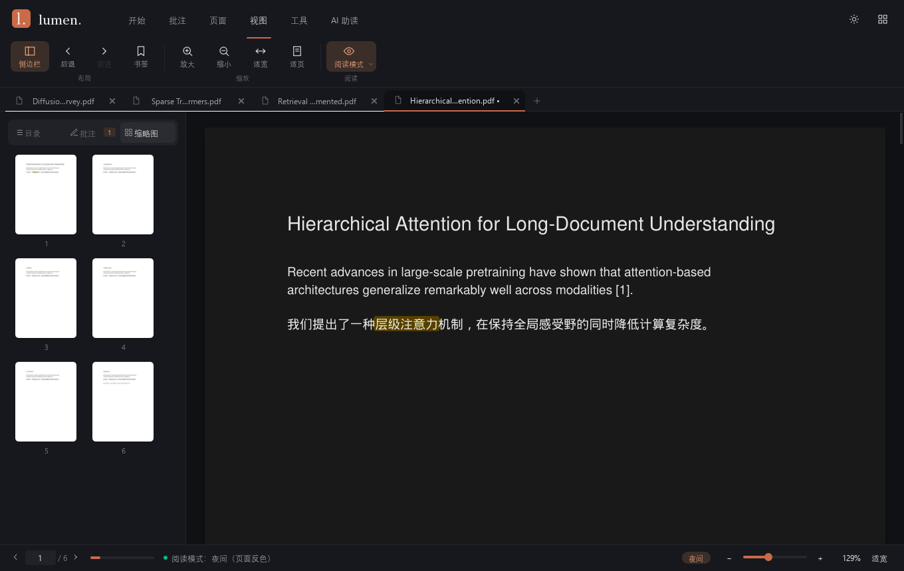

# 界面与交互规范（Lumen）

> 适用版本：Lumen 0.0.5（第二版设计稿）。面向修改界面 / 动效的人：布局、设计令牌、控件接口、动效与约束。
> 界面依据 Lumen 第二版设计稿（本地 `UI/`，React 原型，不入库：`App.tsx` / `lumen/Studio.tsx` /
> `lumen/Ribbon.tsx` / `index.css`）实现。功能本身见 [01_功能说明](01_功能说明.md)。
> 逐控件的尺寸、全部文案、状态、动效参数与重设计契约见 [07_界面重设计参考](07_界面重设计参考.md)。

## 1. 布局

窗口最外层是 `QStackedWidget`（`#Shell`）：**文献库首页** ⇄ **阅读器**。没有打开的文档时显示首页；
阅读器里点品牌「lumen.」或右上角网格按钮回首页（标签与文档都保留，首页顶栏出现「返回阅读」）；
从首页打开 / 继续 / 点卡片回到阅读器。首页显示时阅读器快捷键停用（Ctrl+O 照常），窗口标题为「Lumen」。

```
文献库首页（gui/widgets/library.py · LibraryHome）
┌────────────┬──────────────────────────────────────────────────────────┐
│ lumen.     │ 工作空间 › 全部文档        [← 返回阅读] 本地 | [☾] (L)    │ 顶栏 70px
│ 我的阅读空间 │  让每一次阅读，都有回响。                    （右侧摘要）  │
│ [+ 导入 PDF]│ ┌从上次的思考继续──────────────┐ ┌AI 助读────────┐        │
│ 文献库      │ │ 书名 / 作者 / 进度 / 继续阅读 │ │ 探索 AI 助读 →│        │
│  全部 / 最近 │ └──────────────────────────────┘ └───────────────┘        │
│  收藏 / 笔记 │ 我的文献库 03   [全部 3][ml][report]  搜索… 排序 [▦][≡]   │
│ 合集（文件夹）│ ┌封面┐ ┌封面┐ ┌封面┐ ┌封面┐   （网格 4 / 2 列，或列表）   │
│ 墨绿导航栏   │ 为你的下一次灵感，留一个位置（拖入高亮）    页脚 · 关于 Lumen │
└────────────┴──────────────────────────────────────────────────────────┘

阅读器
┌──────────────────────────────────────────────────────────────────────┐
│ [l.] lumen.   开始 批注 页面 视图 工具 AI助读（弹性指示线）    [☾] [▦] │ 标题栏 58px
│ ┌文件──────────┐┌编辑──┐┌工具──┐┌查找与复制─────┐                    │ 功能区 68px
│ [▤ 论文A.pdf ✕][▤ 论文B.pdf • ✕] [+]                                  │ 标签栏 32px（有文档时）
├──────────────┬───────────────────────────────────────────────────────┤
│ 侧边栏 280px │        [● 拖拽选字以高亮  Esc]          [搜索浮层 340px] │
│目录|批注|缩略|素材│  阅读区：居中页面 + 阴影，连续滚动                     │
├──────────────┴───────────────────────────────────────────────────────┤
│ ‹ [1] / 6 › ━━──  ● 消息（2.8 秒消失）      夜间  − ──●── + 132% 适宽 │ 状态栏 40px
└──────────────────────────────────────────────────────────────────────┘
```

| 区域 | 代码 | 说明 |
| --- | --- | --- |
| 文献库首页 | `gui/widgets/library.py`（`LibraryHome`） | 导航（分区 / 合集）、问候、继续阅读卡、AI 助读卡、筛选 / 搜索 / 排序 / 视图、文档卡片、导入区；响应式断点 xl/lg/md/sm/xs |
| 标题栏 + 功能区 | `gui/widgets/ribbon.py`（`Ribbon` / `RibbonButton`） | 品牌（回首页）、选项卡（弹性指示线）、主题、网格（回首页，提示当前文档名 / 未保存）；按组标题分组的按钮，由 `QAction` 驱动，选中底色自绘缩放 |
| 标签栏 | `gui/widgets/doc_tabs.py`（`DocumentTabBar`） | 每份文档一个标签（文件图标，宽 80–220），可拖动、可关闭，右侧「+」打开；信号 `closeOthersRequested(int)` |
| 侧边栏 | `gui/panels/sidebar.py`（`SidePanel`） | 分段切换：目录 / 批注 / 缩略图 / 素材；宽度可拖动（`set_panel_width`） |
| 阅读区 | `gui/widgets/pdf_view.py`（`PdfView`） | 渲染、选择、批注预览、链接、阅读模式 |
| 搜索浮层 | `gui/panels/search_panel.py`（`SearchPanel`） | 右上角卡片 |
| AI 面板 | `gui/panels/ai_panel.py`（`AiPanel`） | 阅读区右侧抽屉（默认 380px），宽度动画显隐（Ctrl+J）；每个标签一个面板，叠在 `AiDock` 里 |
| 宽度拖动条 | `gui/widgets/panel_grip.py`（`PanelGrip`） | 浮在侧栏内侧边缘的 6px 热区（不占布局、不盖阅读区滚动条），悬停 / 拖动显示 2px 强调色线；拖动实时改宽度，松手存设置，双击恢复默认。范围：侧边栏 220–520、AI 面板 320–760，且阅读区至少留 360 |
| 浮层 | `gui/widgets/overlays.py`（`ToolHint` / `CitePopover`） | 工具提示胶囊；引用预览卡 |
| 划词翻译 | `gui/widgets/translate_popup.py`（`TranslatePill` / `TranslatePopup`） | 选区末尾的「译」胶囊（弹出）；译文浮窗宽 360、圆角 12、`popover` 底，出现在选区下方（放不下放上方），自上落下；译文区最高 260 超出滚动；标题栏可拖动，钉住 / 连翻按钮开着时淡强调底 + 强调色图标 |
| 状态栏 | `gui/widgets/status_bar.py`（`StatusBar`） | 翻页、进度、消息、模式标签、缩放 |
| 动效 | `gui/widgets/motion.py` | fade_up / drop_in / pop_in / slide_in / pop_out / tween（数值补间） |
| 主窗口 | `gui/main_window.py`（`MainWindow`） | 把以上控件接到控制器与后台线程 |

功能区分组（选项卡顺序与名称有测试约束，改动需同步 `tests/unit/gui/test_main_window.py`、`test_lumen_ui.py`）：

| 选项卡 | 分组 |
| --- | --- |
| 开始 | 文件（打开 / 保存 / 另存为 / 打印 / Zotero 批注 / 关闭）· 编辑 · 工具（选择 / 抓手）· 查找与复制（搜索 / 去换行复制 / 翻译） |
| 批注 | 文字标记（高亮 / 颜色 / 下划线）· 绘制（手写 / 便签 / 文本框 / 橡皮擦）· 插入（签名 / 时间） |
| 页面 | 当前页 · 第 N 页（删除页 / 旋转 / 合并 / 水印） |
| 视图 | 布局（侧边栏 / 后退 / 前进）· 缩放（放大 / 缩小 / 适宽 / 适页）· 阅读（阅读模式） |
| 工具 | 识别（OCR）· 输出（导出 / 导出笔记）· 文档（文档信息） |
| AI 助读 | 全文（AI 面板 / 总结全文 / 推荐问题）· 速读（TL;DR / 速读高亮）· 划词与框选（翻译 / 解释 / 框选提问）· 模型（模型设置） |

> 与设计稿的差异：「文件」组额外保留「另存为」「关闭」（设计稿没有可见入口）；「关于」从标题栏移到首页页脚。
> 首页额外提供收藏（卡片星标）与「阅读笔记」分区（有批注的文档），设计稿只有静态示意。

## 2. 设计令牌（`gui/theme/palette.py`）

| 令牌 | 浅色 | 深色 | 用途 |
| --- | --- | --- | --- |
| `window` / `canvas` | #F6F5F1 | #0F1115 | 主背景 / 阅读区（暖纸底） |
| `surface` | #FCFBF8 | #16181D | 标题栏、功能区、侧边栏、状态栏 |
| `popover` | #FFFFFF | #1D2027 | 菜单、浮层卡片 |
| `text` / `text_muted` | #30312E / #92938A | #E4E4E7 / #71717A | 正文 / 次要文字 |
| `accent` | #C96A49 | #C96A49 | 强调色（赤陶 terracotta） |
| `accent_soft` / `accent_text` | #F5E9DF / #B75B3C | #3B2E28 / #E8A17E | 选中底色 / 强调文字 |
| `brand_from` → `brand_to` | #C96A49 → #B75B3C | 同左 | Logo 方块 |
| `danger` / `success` / `mark` | #F43F5E / #10B981 / #FCD34D | #FB7185 / #10B981 / #B45309 | 危险操作 / 消息圆点 / 搜索命中 |
| `nav` / `nav_text` / `nav_active` | #282D29 / #C2C7BD / #3B423A | 同左 | 首页墨绿导航栏 |
| `hero` / `insight` | #EAECE2 / #EEE6DA | #303A30 / #3C352D | 首页「继续阅读」卡 / 「AI 助读」卡 |
| `covers` | sage / sand / rose / blue 四组（底色, 墨色） | 同左 | 文档封面，按路径稳定选一种 |

* 字体：界面 Inter → Segoe UI → 微软雅黑；标题与引文 Source Serif 4 / Noto Serif SC → 宋体 → Georgia。
* 设计稿里的半透明叠色已预先与底色合成为不透明色（Qt 样式表对 rgba 叠加的表现与浏览器不同）。
* 高亮色板：#FACC15 / #4ADE80 / #60A5FA / #F472B6 / #FB923C。
* 图标为内置 SVG 路径（24×24，线宽 1.6），按主题色渲染；下拉按钮的小箭头由样式表引用生成的 SVG 文件绘制。
* **改视觉先改令牌与 `stylesheet.py`，不要把颜色写死进控件。**

## 3. 动效（`TOKENS.anim_*`，缓动 OutExpo ≈ cubic-bezier(.22,1,.36,1)）

| 落点 | 效果 | 时长 |
| --- | --- | --- |
| 选项卡切换 | 指示线弹性移动（领先边 320ms，后随边 500ms 延迟 80ms）+ 工具页横向滑入 ±18px + 组标题落下 | 320 / 500 / 360ms |
| 功能区按钮选中 | 强调色底从 50% 缩放到 100% 并淡入 | 420ms |
| 首页进入 | 问候、继续卡、AI 卡、前 8 张卡片依次自下淡入（间隔 70ms） | 500ms |
| 首页卡片悬停 | 上浮 5px + 柔和阴影 | 400ms |
| 首页 → 阅读器 | 阅读区自下淡入 | 500ms |
| 侧边栏显隐 | 宽度 0 ↔ 用户宽度（默认 280） | 500ms |
| 分段切换 | 滑块滑动；内容淡入 | 400ms / 320ms |
| 搜索浮层 | 自上落下；结果逐条淡入（30ms 错开） | 320ms |
| 工具提示 / 模式标签 / 引用预览卡 | 落下淡入 | 320ms |
| 跳转 | 平滑滚动 + 目标页外扩光环 ×2 | 380ms / 900ms |
| 标记提交 / 搜索命中 | 闪动淡出 / 脉冲 | 450ms / 900ms |
| 页面渲染 | 位图淡入（编辑后的重绘不淡入，避免闪烁） | 320ms |
| 状态栏 | 消息淡入，2.8 秒后消失；进度条平滑增长 | 320ms / 500ms |

动画只作用于显示层，不改变数据操作的顺序；`motion.set_enabled(False)` 全局关闭（测试默认关闭）。

## 4. 控件接口

重做控件时保持（或等价替换）以下信号与方法，主窗口接线即可沿用。

### 4.1 `PdfView`

| 信号 | 参数 | 含义 |
| --- | --- | --- |
| `pageChanged` | `int` | 当前页变化（视口中露出最多的页） |
| `renderRequested` | `int` 页, `float` 逻辑缩放 | 需要渲染；主窗口用 `render_scale(page)` 取实际倍率 |
| `zoomChanged` | `float` | 缩放变化 |
| `textCopied` | `int` | 已复制字符数 |
| `annotationHighlight` | `int`, `tuple[Rect, ...]` | 高亮工具松开（每行一个矩形） |
| `markupRequested` | `int`, `tuple[Rect, ...]`, `str` | 下划线工具 / 右键菜单的文字标记 |
| `annotationInk` / `annotationNote` / `eraseRequested` | `int`, `InkStroke` / `Point` / `Point` | 手写 / 便签（含文本框）/ 橡皮擦 |
| `placementRequested` / `placementFinished` | `int`, `Point`, `str`, payload / — | 签名、时间的放置与结束 |
| `linkActivated` | `int` 所在页, `LinkInfo` | 单击链接 |

| 方法 | 用途 |
| --- | --- |
| `setup_document(count, sizes, *, keep_page, keep_offset)` | 布局并定位（编辑后保持当前页） |
| `on_page_rendered(page, zoom, data)` / `render_scale(page)` | 渲染回填 / 渲染倍率 |
| `jump_to_page(page, y=None, *, animate)` / `restore_position(page, offset, *, animate)` / `reading_position()` | 跳转与阅读位置 |
| `set_zoom` / `zoom_in` / `zoom_out` / `set_zoom_percent` / `fit_to_width` / `fit_to_page` / `set_actual_size` | 缩放 |
| `set_reading_mode(mode)` / `highlight_color` | 阅读模式 / 高亮预览色 |
| `pulse_page(page)` / `flash_rects(page, rects, color)` | 跳转脉冲 / 标记闪动 |
| `show_search_hit` / `clear_search_hit` | 搜索命中 |
| `selection_rects` / `clear_selection` / `copy_selection(merge_lines=…)` | 选择 |
| `invalidate_page(page)` | 页内容变化后丢缓存 |
| `set_text_provider` / `set_link_provider` / `set_annotation_controller` | 依赖注入 |
| `arm_placement(kind, payload)` / `clear_pending()` | 放置模式 |
| `apply_palette(palette)` | 主题切换 |
| `release_render_cache()` / `request_visible()` / `settle_scroll()` | 标签切到后台释放位图 / 切回前台重新请求可见页 / 平滑滚动立即落到终点 |

### 4.2 其他控件

* **`SidePanel`**：信号 `tocActivated(int, object)`、`annotationActivated / annotationEditRequested /
  annotationDeleteRequested(Annotation)`、`exportNotesRequested()`、`thumbnailActivated(int)`、
  `thumbnailsNeeded(list[int])`；方法 `set_toc`、`set_annotations`、`set_page_count`、`set_thumbnail`、
  `invalidate_thumbnail`、`set_current_page`、`clear`；`tabs` 提供 `currentIndex / setCurrentIndex / currentChanged`，
  页签常量 `TAB_TOC / TAB_ANNOTATIONS / TAB_THUMBNAILS`。
* **`SearchPanel`**：信号 `searchRequested(str)`、`resultClicked(int, Rect)`、`closed()`；方法 `show_results`、
  `show_error`、`select_relative(step)`、`focus_input`、`clear`。
* **`StatusBar`**：信号 `prevRequested / nextRequested / pageEntered(int) / zoomInRequested / zoomOutRequested /
  fitRequested / zoomPercentRequested(int)`；方法 `show_message / message / set_page / set_zoom /
  set_reading_mode / set_document_active`。
* **`Ribbon`**：`add_tab(title, [(组标题, [actions])])`（返回组标题标签）、`set_menu(action, menu)`、
  `set_document_title(name, *, dirty=False)`、`home_tooltip()`、`current_index()`、`add_trailing_action`、`finish`、
  `button_for(action)`（返回 `RibbonButton`，`fill` 为选中底色进度）；信号 `themeToggleRequested / homeRequested`。
* **`LibraryHome`**：信号 `openRequested / openRecentRequested(str) / favoriteToggled(str) / themeToggleRequested /
  aboutRequested / exploreAiRequested / returnRequested / viewModeChanged(str)`；方法 `set_entries(list[LibraryEntry])`、
  `entries / entry_paths / folders`、`set_section / set_folder / reset_filters`、`set_view_mode(mode, *, notify)`、
  `set_can_return(can, tip)`、`set_dragging(bool)`、`focus_search`（Ctrl+K）、`animate_in`、`apply_width(width)`。
  `LibraryEntry` 由主窗口据设置组装：最近文件（最多 `MAX_LIBRARY_FILES` 40 个，找不到的不列出）+ `DocMeta`
  摘要（页数 / 批注数 / 标题 / 作者 / 打开时间，打开与保存时记录）+ 阅读位置算出的进度 + 收藏 + 是否已打开。
  纯函数 `display_title`（元数据标题不可用时退回文件名）、`relative_time`、`cover_variant`、`filter_entries` 可单测。
* **`ToolHint`**：`show_tool(mode, color)`；**`CitePopover`**：`show_at(global_pos, title, body)`，信号 `jumpRequested`。
* **`TranslatePill`**：`show_near(anchor)`（贴在选区最后一个词的右下）。**`TranslatePopup`**：信号 `closed / pinnedChanged(bool) /
  continuousToggled(bool) / captureRequested / panelRequested`；方法 `place_near(selection_rect | None)`（钉住或拖动过时保持原位）、
  `begin(source, segments)`、`append(delta)`、`finish(text)`、`fail(msg)`、`show_garbled(source)`、`show_message(text)`、
  `set_continuous(on)`（不发信号）、`dismiss()`。高度按 `heightForWidth` 计算（换行标签不会被压成一行）。
* **`AiPanel`**：信号 `askRequested(str) / actionRequested(str) / captureRequested / stopRequested / settingsRequested /
  citationClicked(int，1 起页码) / saveNoteRequested(str) / clearRequested / closeRequested`；方法 `set_configured`、
  `set_provider_label`、`set_page_count`、`begin_turn(title, quote, *, label, image)`、`append_reasoning`、`append_delta`（80ms 节流，只重绘最后一条）、
  `finish_turn(text, questions=)`、`fail_turn`、`cancel_turn`、`clear`、`prefill`、`last_answer`、
  `attach_context(text, label)` / `attachment()` / `clear_attachment()`（「问 AI…」引用，随下一问发送后收起）、
  `transcript_markdown()` / `transcript_text()`。内部链接协议：`cite:N` 跳页、`ask:i` 推荐问题、`action:settings` 打开设置。
* **对话视图**（`panels/ai_chat.py`）：`ChatView`（`QScrollArea#AiChat`，贴底自动滚动，用户上翻后不打扰）按回合放一对气泡——
  右侧 `AiUserBubble`（`accent_soft` 底，圆角 14、右上 4，最宽 84%）：引用卡片 + 请求标题；左侧 `AiBotBubble`（`popover` 底 +
  描边，左上 4，最宽 94%）：等待点阵 + 状态字、`AiAnswer`（QTextDocument 把 Markdown 转富文本，链接用 `accent_text`，
  `cite:` 页码淡底小标签，标题最多比正文大 1px；正文先经 `textfix.tidy_markdown` 整理标点与公式，`**…**` 转 `<b>` 避开 md4c 在中文标点边界不认加粗的问题，行间公式段落居中）、推荐问题（`AiQuestion` 可点）、`AiError`、「已停止」、
  `AiBubbleAction`「复制」（点后 1.5s 显示「已复制」）/「存为批注」（只在最后一条）。`ContextCard`（`#AiContext`，左侧 3px
  强调色竖条）默认折叠为「选中内容 · 第 N 页 · 字数」+ 一行省略摘要，点开显示可选中的全文（最多 4000 字）或框选截图；
  `closable` 时（`attached=true`，`surface_hover` 底）放在输入框上方。无对话时显示 `_EmptyState`（未配置时带「配置模型 →」与隐私说明）。
* **`PdfView`（AI 相关）**：`areaCaptured(int, Rect)`（框选工具松开，≥ 6pt 才发）、`aiRequested(str)`（右键 translate / explain / ask）；速读标记 `set_marks(page, rects)`（空序列清除该页）/ `clear_marks()` / `marks()`——强调色淡底叠加层，缩放重排后重画，`setup_document` / `clear` 时清空。

### 4.3 对话框

| 对话框 | 文件 | 要点 |
| --- | --- | --- |
| 导出 | `gui/dialogs/export_dialog.py` | `ExportDialog(source, parent, *, display_path, page_count, password)`；转换中禁止关闭 / Esc |
| OCR 结果 | `gui/dialogs/ocr_result_dialog.py` | 全文、复制全部、另存 TXT |
| 签名 | `gui/dialogs/signature_dialog.py` | 手绘 / 选图；`image_path()`、`is_temporary` |
| 关于 | `gui/dialogs/about_dialog.py` | 品牌与版本 |
| AI 模型设置 | `gui/dialogs/ai_settings_dialog.py` | 服务列表 + 表单；获取模型 / 测试连接走 `AiWorker`；确定后 Key 才写入凭据管理器 |
| 密码 / 水印 / 便签 / 笔记 | `QInputDialog`（主窗口内） | 可替换为自定义对话框，保持返回值语义 |

### 4.4 反馈渠道

* **状态栏消息**：轻量结果（已复制、已跳转、已保存、工具切换），2.8 秒后消失。状态栏属于阅读器，
  首页上的操作（收藏、切视图）以控件自身状态为反馈，不发状态栏消息。
* **警告框**：操作失败，标题「xx失败」，内容为 `DocumentController.last_error`（已脱敏）。
* **确认框**：删除页、覆盖文件、打开外部链接、保存更改；AI 首次向某服务外发、加密文档外发、大段外发。
* **进度**：OCR / 打印用进度对话框，导出用对话框内进度条，生成快照时显示忙碌光标。



## 5. 修改界面时的约束

1. 视图坐标换算只做「÷ zoom、减去页偏移」，不处理旋转（引擎对外一律可见帧）。
2. 渲染在主线程、渲染受控文档；后台线程只读快照或原文件。
3. 编辑后用 `setup_document(..., keep_page=…)` 保持当前页。
4. 控制器调用返回 False 时必须展示 `last_error`。
5. 切换 / 关闭文档回收后台线程（`_reset_document_session`），退出前等待线程结束；线程运行中对话框不可关闭。
6. 导出默认位置用真实文档路径，快照目录只放快照。
7. 连接全局主题单例 `get_theme().changed` 时用**绑定方法**，不要用 lambda（对象销毁后 lambda 连接不会自动断开）。
8. 颜色走令牌；PDF 页面保持白色，夜间 / 护眼由视图对位图着色。
9. 视觉改动后运行 `scripts/capture_screenshots.py` 生成各状态截图人工比对。
